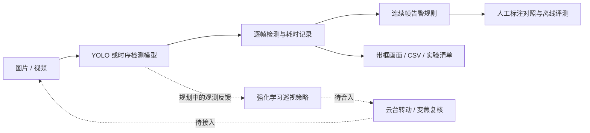

<div align="center">

# eletric_chicken · 电鸡哨兵

**面向电动自行车停放与充电场景的烟火视觉感知与主动巡视研究**

YOLO 烟火检测 · 场景定向微调 · 连续帧告警评测 · 强化学习主动巡视

*Smoke & Fire Detection · Towards Reinforcement Learning for Active Camera Patrol*

[](requirements.txt)
[](requirements.txt)
[](sentinel/models/catalog.py)
[](LICENSE)
[](#项目进展)

[快速开始](#快速开始) · [模型权重](#模型与权重) · [数据与标注](#数据与标注) · [评测记录](#实验与评测) · [开发路线](#项目进展)

</div>

---

## 项目介绍

电鸡哨兵关注电动自行车停放、充电场所中的可疑烟雾与明火。车辆遮挡、远端小目标和复杂背景，让早期薄烟的识别与复核成为项目的核心问题。

项目围绕两个问题展开：**YOLO 负责识别画面中的烟与火，强化学习策略负责决定摄像机看哪里、何时转动、何时变焦复核。** 从视觉检测到主动巡视，目标是研究感知与决策协同的预警流程。

**当前已完成视觉检测、定向微调、多模型比较和连续帧告警离线评测。强化学习模块由协作者开发中，尚未合入本仓库；仿真与真实云台闭环仍待接入和验证。**

## 核心能力

- **面向场景的模型微调。** 基于 D-Fire YOLOv8n，结合人工审核图片、背景干扰帧和重点样本采样，保留基础版与定向版供同条件对照。
- **图片与视频统一检测。** 支持单图、图片目录和视频输入，输出检测框、类别、置信度及带框画面；视频逐帧读取，无需整段载入内存。
- **连续帧告警评测。** 离线比较连续 1 / 3 / 5 个采样帧命中规则；结合人工真值，分析告警稳定性、无烟帧告警比例与首次有效触发延迟。
- **可追溯的多模型实验。** 记录素材与权重 SHA-256、实际输入尺寸、阈值、抽帧间隔，以及预热和稳定态耗时，保留逐帧 CSV 与实验清单。
- **公开权重与标注入口。** 提供三份本地微调最佳权重，以及人工审核训练帧、YOLO 标签和历史参考测试图，附来源与使用边界。
- **多种检测基线。** 接入 FireSmockDetect、Early Fire and Smoke、D-Fire、Safety YOLO26 与 LwST-FSD 五帧模型；配置集中维护，支持相同素材上的对照。

## 工作流程



实线为已实现的离线检测与评测流程；虚线为协作开发及后续集成部分。代码按模型、处理流程、媒体和评测拆分，模块入口见 [代码导览](docs/code_map.md)。

## 模型与权重

### 当前展示模型：`dfire_ludan_focused`

面向电动车相关烟雾素材定向微调的 **YOLOv8n**，检测 `smoke` / `fire` 两类，登记输入尺寸 **960**，权重约 **6.26 MB**。

本轮从 `dfire_ludan` 继续训练：762 张不同训练图片，包含 140 张人工审核图片；对人工审核组和 32 张 jjs 干扰帧提高采样比例。完成 30 轮训练，按参考验证集 mAP50–95 保留第 22 轮最佳权重。

**[查看 / 下载最佳权重](runs/dfire_ebike_focused/experiment_002/train/weights/best.pt)** · [训练与选择记录](docs/ebike_focused_local.md) · [机器可读评测摘要](reports/training/ebike_focused_20261031.json)

定向版在参与训练的人工标注图与专项回放中有所改善，同时存在背景误报和旧参考测试集退化。它用于展示本轮场景适配成果，效果需结合素材与阈值判断，详细条件见 [实验与评测](#实验与评测)。

### 保留的对照版本

- [`dfire_ludan`](runs/dfire_ludan/experiment_002/train/weights/best.pt)：定向版的训练起点，保留用于回归比较。
- [`dfire_small_smoke`](runs/dfire_fasdd_small_smoke/experiment_001/train/weights/best.pt)：此前的小烟雾微调版本。
- 上游基线与时序模型：来源、哈希及输入配置统一维护在 [`sentinel/models/catalog.py`](sentinel/models/catalog.py)，实验记录见 [模型对比](docs/model_comparison.md)。

三份本地微调最佳权重随仓库提供。需要额外模型时，使用下载脚本按模型标识获取并校验；各模型的许可与使用条件见 [NOTICE.md](NOTICE.md)。

## 快速开始

已验证环境为 **Windows + Python 3.13 + PyTorch 2.8.0 / CUDA 12.9 + NVIDIA GPU**。以下命令在仓库根目录的 PowerShell 中执行；其他平台需选择兼容的 PyTorch 构建。

### 1. 安装并校验

```powershell
git clone https://github.com/ctmd1234567/eletric_chicken.git
cd eletric_chicken
python -m venv .venv
.\.venv\Scripts\python.exe -m pip install -r requirements.txt
.\.venv\Scripts\python.exe -m pip check
.\.venv\Scripts\python.exe scripts/verify_cuda.py

# 校验仓库附带的定向微调权重
.\.venv\Scripts\python.exe scripts/download_models.py --only dfire_ludan_focused --check
```

`requirements.txt` 固定 `dill==0.3.8`，请保留该版本，以避免旧 checkpoint 加载时的 PyTorch 兼容问题。保存带框视频还需要 **FFmpeg**，并将其加入 `PATH`。

### 2. 运行图片检测

准备一张有权使用的图片，保存为 `samples/test.jpg`：

```powershell
.\.venv\Scripts\python.exe scripts/compare_models.py --source samples/test.jpg --models dfire_ludan_focused --device 0 --conf 0.25 --save-images
```

将 `--source` 换成图片目录即可批量处理。结果保存到 `samples/images_results/run_编号/`，包含检测明细、汇总 CSV 和带框图片。

### 3. 运行视频检测与告警对照

准备视频 `video/test.mp4`：

```powershell
.\.venv\Scripts\python.exe scripts/video_baseline.py --source video/test.mp4 --models dfire_ludan_focused --device 0 --conf 0.15 --stride 1 --consecutive 1 3 5 --save-images
```

每次运行创建独立目录，主要产物如下：

```text
samples/video_results/run_编号/
├── manifest.json              素材、权重、实际参数与完成状态
├── detections.csv             逐帧时间、检测框与耗时
├── summary.csv                检出帧占比及稳定态推理耗时
├── annotations_template.csv   待人工填写的区间标注模板
├── temporal/                  连续帧告警状态、事件与统计
└── 模型名_视频名.mp4            带框视频，启用保存时生成
```

`--device 0` 使用第一张 GPU，CPU 改为 `--device cpu`；`--stride 1` 表示逐帧检测。示例阈值用于实验起步，部署阈值需按场景标注校准。输出视频不含音轨，告警对照结果保存在 CSV 中。详细用法见 [视频评测说明](docs/video_baseline.md)。

<details>
<summary><b>在 PyCharm 等编辑器中直接运行</b></summary>

选择项目 `.venv` 解释器，修改入口顶部参数后运行：

- [`scripts/run_models.py`](scripts/run_models.py)：快速检测与多模型比较。选择定向版可设置 `MODELS = ["dfire_ludan_focused"]`。
- [`scripts/run_video_baseline.py`](scripts/run_video_baseline.py)：视频检测与连续帧告警对照。选择定向版可设置 `MODELS = {"dfire_ludan_focused": 960}`。

`SOURCE` 指向实际素材，`CONFIDENCE` 控制置信度，`IOU` 控制重叠框抑制，`SAVE_IMAGES` / `SHOW_IMAGES` 控制保存与预览。两处入口独立配置，实际启用模型以各自文件为准。

</details>

## 数据与标注

已公开的 [数据与标签目录](data/yolo/real_ebike/) 包含：

- **140 张人工审核训练图及 YOLO 标签**，其中 14 张为无肉眼可辨认烟雾的背景帧。这组图片已参与定向训练。
- **150 张 FASDD 历史参考测试图及标签**，用于检查旧参考集上的性能变化；并非独立的电动车场景测试集。
- 逐文件 SHA-256、来源清单与实验记录。类别统一为 `0=smoke`、`1=fire`。

目录名 `real_ebike` 不表示其中全部图片都是电动车事故。FASDD 参考图保留其 **CC BY-SA 4.0** 条件与署名，详情见 [数据说明与来源](data/yolo/real_ebike/README.md)。原始视频、其余训练集和完整训练产物不随仓库提供。

## 实验与评测

项目重点记录薄烟召回、无烟场景误报、推理延迟、首次有效报警时间与告警稳定性。评测时固定素材、阈值与抽帧间隔，并记录各模型实际使用的尺寸和 NMS 配置。

当前结果需要结合以下条件阅读：

- **训练回放：** 在 960 输入、置信度 0.15、框匹配 IoU≥0.5 时，本次人工组 101 个烟雾框的正确匹配由基础版的 2 个增至定向版的 93 个。这组图片参与过训练，只说明拟合变化。
- **参考集回归：** 同轮记录的 150 张旧参考测试图上，整体 mAP50–95 由 0.45023 降至 0.38201；定向适配存在性能取舍。
- **场景能力：** 尚无按事故独立划分的新场景标注测试集，真实车棚的薄烟召回、误报率和预警时间仍待验证。

没有人工真值的视频只报告检测输出与告警行为；**有框帧占比不等于召回率，首次触发位置也不等于提前预警时间。** 连续帧规则当前是场景级离线对照，尚未包含目标跟踪或烟羽关联。

[定向微调与固定阈值对比](docs/ebike_focused_local.md) · [多模型实验记录](docs/model_comparison.md) · [告警规则与标注方法](docs/video_baseline.md) · [上游推理配置](docs/upstream_inference.md)

## 项目进展

- [x] 多模型加载、固定来源与权重哈希校验
- [x] 图片、目录与流式视频检测，带框画面与 CSV 输出
- [x] 小烟雾及电动车相关素材定向微调，保留版本对照
- [x] 人工审核训练帧、配对标签和历史参考图整理与发布
- [x] 连续帧告警规则与人工标注离线评测
- [ ] **强化学习巡视策略：协作者开发中，待合入本仓库**
- [ ] 巡视仿真环境与感知—决策联调，比较固定巡航、规则复核和学习策略
- [ ] ONVIF 云台转动、变焦与可疑区域复核闭环
- [ ] 独立事故测试集、实地验证及可视化管理平台

完整研究方向见 [项目方案 PDF](电鸡哨兵-基于强化学习与yolo算法.pdf)。清单表示当前代码与集成进度，最终效果以合入后的实验验证为准。

## 代码与文档

```text
scripts/                 检测、比较、训练及数据处理入口
sentinel/
  models/                模型登记、加载与推理适配
  pipelines/             图片与视频处理流程
  media/                 素材读取、视频编码与下载
  evaluation/            连续帧告警与标注评测
  training/              标注导入、数据准备、训练与专项评测
data/yolo/real_ebike/     已公开的训练帧、标签与历史参考图
docs/                    使用说明、设计与实验记录
reports/training/        公开训练评测摘要
runs/                    指定最佳权重；其余实验产物忽略
tests/                   回归测试
```

- 理解与修改代码：[代码导览](docs/code_map.md)
- 准备数据与复核实验：[训练数据扩充](docs/training_data_expansion.md) · [本地定向微调](docs/ebike_focused_local.md)
- 云端训练与环境迁移：[AutoDL 部署](docs/autodl_3080ti.md)
- 后续评测设计：[恶劣天气与鲁棒性](docs/weather_robustness.md)

欢迎通过 [Issues](https://github.com/ctmd1234567/eletric_chicken/issues) 反馈复现问题或讨论场景评测。提交问题时请附模型标识、运行参数、环境版本和可公开的日志；素材分享需具备相应权限。

## 许可

项目采用 [AGPL-3.0](LICENSE)。第三方权重、数据与素材分别遵守其原有条款，具体来源与许可见 [NOTICE.md](NOTICE.md)。
